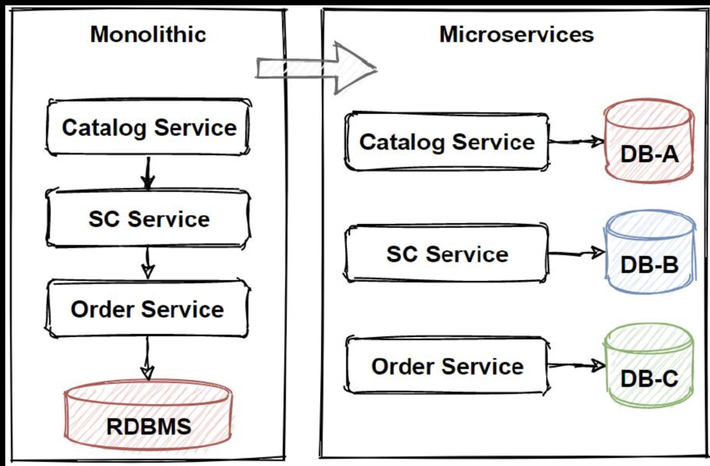
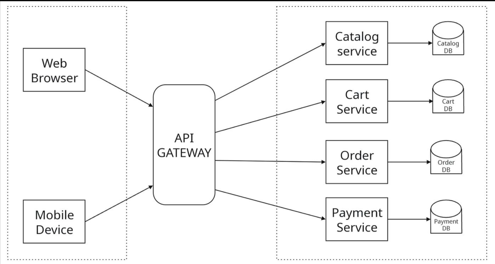
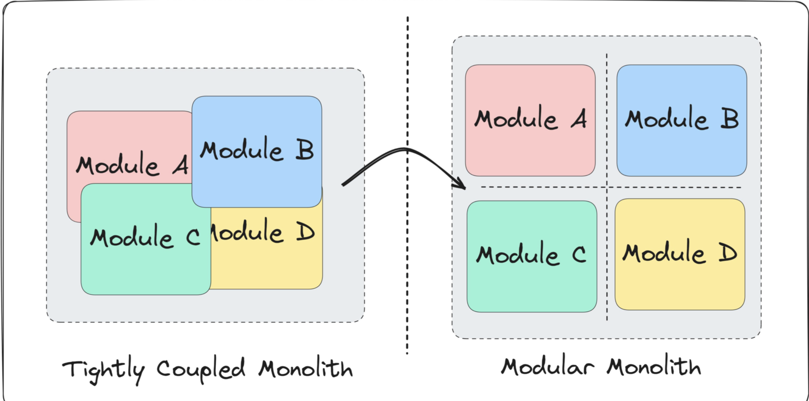

# 🚀 Microservices vs Monolith Architecture

## ✍️ Author  
**AyushM**

---

## 🌟 Overview

This document explains:

- Monolithic Architecture  
- Microservices Architecture  
- Migration from Monolith → Microservices  
- Key Design Patterns  

---

# 🧱 Monolithic Architecture

  

### 📌 Definition

Monolithic architecture is a type of architecture where **all modules of an application are kept inside a single codebase**.

- All modules are **tightly coupled**
- Entire system is deployed as one unit

---

### 🧠 Example: E-commerce Application

Modules:
- Auth  
- Cart  
- Order  
- Payment  

👉 If **one module fails (e.g., Payment)**  
❌ The whole application may crash

---

### ⚠️ Problems

#### ❌ Tight Coupling
- Modules depend on each other heavily

#### 🚨 Single Point of Failure
- One failure can break the entire system

#### 🔁 Deployment Bottleneck
- Small change → full application redeployment

#### 📈 Scaling Issue

Example:
- Payment → 5 lakh requests  
- Auth → 5k requests  

👉 Still, entire application must scale → **higher cost**

---

### ⚡ Myth

> ❌ Monolith cannot scale  
> ✔️ It can scale, but only as a whole system

---

### ✅ When to Use

- Small applications  
- Low traffic systems  
- Early-stage projects  

---

# ⚙️ Microservices Architecture

  

### 📌 Definition

Microservices architecture breaks an application into **independent services**, where each service handles a specific functionality.

---

### 🔑 Key Features

- Loosely coupled services  
- Independent deployment  
- Each service can have its own database  

---

### 🧠 Example

Services:
- User Service  
- Payment Service  

👉 If Payment fails  
✅ User service still works

---

### 🚀 Advantages

- 🔄 Independent deployment  
- 📈 Individual scaling  
- 💸 Cost efficient  
- 🧩 Fault isolation  

---

### ⚠️ Challenges

- Complex system design  
- Network latency  
- Debugging is harder  
- Data consistency issues  

---

# 🔥 Monolith vs Microservices

  

| Feature          | Monolith 🧱 | Microservices ⚙️ |
|-----------------|------------|------------------|
| Codebase        | Single     | Multiple         |
| Coupling        | Tight      | Loose            |
| Deployment      | Full App   | Per Service      |
| Scaling         | Whole App  | Individual       |
| Failure Impact  | High       | Low              |
| Complexity      | Low        | High             |

---

# 🔄 Monolith → Microservices Migration

### 🧠 Example (Udemy-like System)

Modules:
- Auth  
- Payment  
- Cart  
- Courses  

👉 Convert **Payment module → Payment service**

---

### 🛠️ Steps

1. Identify high-impact modules  
2. Define API contracts  
3. Choose communication:
   - REST / gRPC (Synchronous)
   - RabbitMQ / Kafka (Asynchronous)  
4. Extract module into service  
5. Monitoring & optimization  
6. Scaling  

---

# 🚦 Canary Deployment

- Start by routing small traffic to new service  
- Example:
  - 90% → Monolith  
  - 10% → Microservice  

👉 Gradually increase if stable  

---

# 🌿 Strangler Design Pattern

- Gradually replace monolith parts  
- Controlled via routing layer  

👉 Example:
- 90% traffic → Monolith  
- 10% → New service  

---

# 🔄 Distributed Transactions

## 🔁 Saga Pattern

- Series of local transactions  
- Uses rollback (compensation) if failure occurs  

---

## 📦 Outbox Pattern

- Ensures data consistency  
- Stores event + data in same transaction  

---

# 🏁 Conclusion

✔️ Start with **Monolith** for simplicity  
✔️ Move to **Microservices** when scaling is needed  

---

## 💡 Pro Tip

> “Microservices are an evolution, not a starting point.”